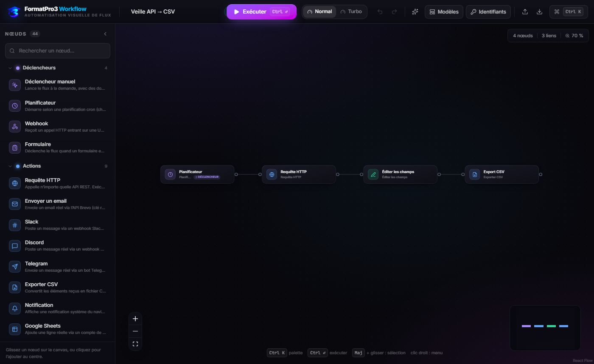

# FormatPro3 Workflow — Automatisation visuelle de workflows

**FormatPro3 Workflow** est un éditeur de workflows par nœuds, inspiré de n8n : on construit un flux en
reliant des nœuds sur un canvas, on configure chaque étape à droite, on exécute, et on
regarde les données circuler de nœud en nœud en temps réel.

Interface en français, thème sombre, animations soignées (particules sur les connexions,
anneau d'exécution sur les nœuds, panneaux à ressorts).

Nouveauté : **publier une vraie vidéo sur 7 réseaux** — YouTube, Mastodon, Bluesky, X,
Instagram Reels, Facebook Page et TikTok — depuis une simple URL.

[](https://github.com/ck526438-lgtm/fluxia/actions/workflows/ci.yml) [](LICENSE)   



**🌐 Démo en ligne : [ck526438-lgtm.github.io/fluxia](https://ck526438-lgtm.github.io/fluxia/)** —
redéployée automatiquement à chaque push. Version 100 % navigateur : le relais local
(Slack, Google Sheets, publication vidéo, API fermées CORS) reste un extra de
l'installation locale.

**📕 Guide d'utilisation complet (PDF, 18 pages) : [docs/guide-utilisation.pdf](docs/guide-utilisation.pdf)** —
installation, visite de l'interface, expressions `{{ … }}`, **référence des 44 nœuds paramètre par
paramètre**, où obtenir chaque clé API, publication vidéo (endpoints, limites, erreurs réelles),
relais local, 6 modèles, raccourcis, tableau de dépannage et bonnes pratiques de sécurité.
Source imprimable : [docs/guide-utilisation.html](docs/guide-utilisation.html)
(`msedge --headless --print-to-pdf=docs/guide-utilisation.pdf docs/guide-utilisation.html` pour le régénérer).

> **Nom** : le produit s'appelle **FormatPro3 Workflow** (logo : `src/assets/logo-formatpro3.png`,
> marque : `src/assets/logo-mark.png`, aussi favicon). Le dépôt et l'URL de la démo portent
> encore l'ancien nom `fluxia` — c'est uniquement l'adresse technique ; renommer le dépôt
> changerait `ck526438-lgtm.github.io/fluxia` en `…/formatpro3-workflow`.

## Démarrage

```bash
npm install
npm run dev      # http://localhost:5173
npm run build    # build de production dans dist/
npm start        # relais local optionnel + sert dist/ sur http://127.0.0.1:5174
```

Le **relais local** (`server.mjs`, zéro dépendance) est facultatif : sans lui, l'app
fonctionne déjà à 100 % en navigateur. Il débloque en plus les API qui refusent les
appels navigateur (CORS) — Slack, Google Sheets, n'importe quelle API fermée via le
nœud Requête HTTP — en les appelant depuis Node, en local uniquement (127.0.0.1).
Il est en revanche **obligatoire pour la catégorie Vidéo** : c'est lui qui télécharge
les octets depuis leur URL et les envoie aux plateformes.

## Fonctionnalités

### Éditeur
- **Canvas infini** : zoom, panoramique, minimap colorée par catégorie, alignement
  automatique des nœuds (dagre), pastille zoom + compteurs nœuds / liens.
- **44 nœuds** répartis en 7 familles : Déclencheurs, Actions, Vidéo, Logique, Données,
  IA, Annotations.
- **Notes autocollantes** : post-it redimensionnables (4 couleurs) pour documenter le
  canvas, sans impact sur l'exécution, rendus derrière les nœuds.
- **Menu contextuel** (clic droit) :
  - sur un nœud → paramètres, **exécuter jusqu'ici**, dupliquer, copier, désactiver, supprimer ;
  - sur une connexion → insérer un nœud, supprimer le lien ;
  - sur le canvas → ajouter un nœud / une note, coller, tout sélectionner, organiser.
- **Palette latérale** : recherche, glisser-déposer ou clic pour ajouter.
- **Connexions** : glisser entre les poignées ; bouton `+` au milieu d'une connexion pour
  y insérer un nœud ; bouton `×` pour la supprimer.
- **Panneau de configuration** : formulaires générés depuis le schéma du nœud
  (texte, nombre, liste, booléen, paires clé/valeur, JSON, éditeur de code).
- **Palette de commandes** (`Ctrl K`) : exécuter, ajouter un nœud, importer, aligner…
- **Identifiants** : panneau central pour enregistrer vos clés API une seule fois
  (Brevo, Notion, Telegram, OpenAI…), réutilisables partout avec `{{ $creds.nom }}`.
  Stockage 100 % local (localStorage), bouton dédié dans la barre d'outils.
- **Modèles prêts à l'emploi** : 6 flux complets (veille API, triage de leads IA,
  résumé IA, webhook enrichi, traitement de commandes, publication vidéo multi-réseaux).
- **Historique** : annuler / rétablir, copier / coller / dupliquer, sauvegarde locale
  automatique (localStorage) avec indicateur « Enregistré », import / export JSON.

### Moteur d'exécution
- Exécution réelle en ordre topologique, branchements `Condition` / `Aiguillage`,
  nœuds ignorés si leur branche n'est pas empruntée, détection des boucles.
- **Expressions** `{{ … }}` partout : `{{ $json.champ }}`, `{{ $items.length }}`,
  `{{ $index }}`, `{{ $node["Nom du nœud"].json.champ }}`, `{{ $now.toISOString() }}`.
- **Animated data flow** : pendant l'exécution, les arêtes s'illuminent avec des
  particules, les nœuds affichent anneau rotatif, coche verte ou secousse d'erreur,
  et le panneau d'exécution détaille entrées / sorties / durée de chaque nœud.
- **Exécuter jusqu'ici** : clic droit sur un nœud → test de l'amont uniquement
  (tous les ancêtres sont exécutés, le reste du flux reste intact).
- Vitesse **Normal** (animations lisibles) ou **Turbo** (instantané).
- Arrêt en cours d'exécution (`Arrêter`).

### Tout est réel — zéro simulation
Chaque nœud effectue une action réelle ou échoue honnêtement avec un message clair.
Aucun nœud ne simule une réponse : sans identifiants, l'exécution s'arrête sur le nœud
concerné avec l'explication exacte (et le lien où créer la clé).

**Intégrations externes réelles** (fonctionnent depuis le navigateur) :

| Nœud | Service | Identifiant requis |
| --- | --- | --- |
| `Envoyer un email` | API Brevo (`api.brevo.com/v3/smtp/email`) | Clé API Brevo + expéditeur validé |
| `Discord` | Webhooks Discord | URL de webhook |
| `Telegram` | API Bot Telegram | Jeton du bot + chat ID |
| `Notion` | API Notion (`api.notion.com/v1/pages`) | Jeton d'intégration + ID de base |
| `Notification` | Notifications du navigateur | Autorisation du site |
| `Requête HTTP` | N'importe quelle API | Selon l'API |
| `Slack` | Webhooks Slack (via relais local) | URL de webhook |
| `Google Sheets` | API Sheets via **compte de service** (via relais local) | Email + clé privée du compte de service, classeur partagé |

Astuce : enregistrez vos clés dans le panneau **Identifiants** puis référencez-les
partout avec `{{ $creds.nom }}` — plus besoin de les ressaisir dans chaque nœud.

### Publier une vidéo sur les réseaux (catégorie Vidéo)

Sept nœuds qui déposent réellement une vidéo sur les plateformes. Le contrat d'API est
différent partout ; FormatPro3 Workflow parle à chaque API officielle, avec le relais local pour les
octets :

| Nœud | Ce qui est réellement appelé | Ce qu'il faut | Ce que la plateforme impose |
| --- | --- | --- | --- |
| `YouTube` | `POST upload/youtube/v3/videos` en `multipart` (chunk JSON + octets) | Jeton OAuth 2.0 avec le scope `youtube.upload` — une clé API seule ne suffit pas, les comptes de service sont refusés | 100 mises en ligne / jour ; `privacyStatus` par défaut privée chez FormatPro3 Workflow |
| `Mastodon` | `POST /api/v2/media` puis **polling** `GET /api/v1/media/:id` jusqu'à l'encodage, `POST /api/v1/statuses` avec `media_ids[]` | Jeton personnel de l'instance (Préférences → Développement), scopes `write:media` + `write:statuses` | Limites lues sur `/api/v2/instance` avant l'envoi (MP4/MOV/WebM, 99 Mio par défaut, une seule vidéo par post) ; 30 envois / 30 min |
| `Bluesky` | `createSession` → `com.atproto.repo.uploadBlob` (octets bruts, sur le **PDS du compte**) → `com.atproto.repo.createRecord` avec `app.bsky.embed.video` | Mot de passe d'application (jamais le mot de passe principal) | MP4 uniquement — le MIME renvoyé par le PDS est vérifié avant publication ; 300 Mio / 10 min sur bsky.social, **5 Mio par défaut sur un PDS auto-hébergé**. Voie simple (fichier déposé tel quel, sans repasser par le service de transcodage de Bluesky) |
| `X (Twitter)` | Protocole v2 : `initialize` → `append` **par segments de 5 Mo** → `finalize` → `STATUS` jusqu'à `succeeded` → `POST /2/tweets` | User access token OAuth 2.0 (`media.write` + `tweet.write`) ; un Bearer applicatif est rejeté | Découpage et attente de transcodage gérés automatiquement ; relais obligatoire (pas de CORS) |
| `Instagram Reels` | `POST /{ig-utilisateur}/media` (`media_type=REELS`, `video_url`) → polling `status_code` → `media_publish` | Compte professionnel lié à une Page, app avec `instagram_content_publish` (en Development Mode, seuls les comptes ayant un rôle publient) | L'URL doit être **publique** : Meta répond 200 même si elle est inaccessible, c'est le polling qui le révèle ; 3 s–15 min ; 15 min entre deux Reels |
| `Facebook Page` | `POST /{pageId}/videos` avec `file_url` | Jeton Page + `publish_video` | 3 s–15 min, 300 Mio ; 100 publications API / 24 h |
| `TikTok` | `/v2/post/publish/video/init` en `PULL_FROM_URL` → `status/fetch` jusqu'à `PUBLISH_COMPLETE` | Jeton `video.publish` d'une app **auditable** : sans audit, `SELF_ONLY` et 5 publications / 24 h | Le domaine de l'URL doit être déclaré/vérifié dans le Developer Portal, sans redirection ; `fail_reason` remonté tel quel (ex. `video_pull_failed`) |

Deux règles communes :

- **le relais local doit tourner** (`npm start`) : c'est lui qui récupère la vidéo à partir
  de son URL, la garde en mémoire 15 minutes et la transmet ;
- l'**URL doit désigner le fichier directement** (`.mp4`, `.mov`, `.webm`…). Une URL qui
  renvoie une page HTML est rejetée localement, avant tout envoi vers la plateforme.

Un nœud vidéo ne télécharge **jamais** quoi que ce soit avant d'avoir vérifié les
identifiants : un jeton oublié échoue en quelques millisecondes avec le chemin exact où
le créer, plutôt qu'après 200 Mo de transfert.

**Traitement 100 % local, sans clé** : `Requête HTTP`, `Code JS`, `Éditer les champs`,
`Condition`, `Aiguillage`, `Filtrer`, `Limiter`, `Trier`, `Éclater`, `Agréger`,
`Dédoublonner`, `Parser JSON`, `Date & Heure`, `Crypto` (SHA-1/256/384/512, Base64, Hex),
`Attendre`, `Fusionner`, `Pause neutre`, `Exporter CSV` (fichier téléchargé),
`Déclencheur manuel`, `Planificateur`, `Webhook`, `Formulaire`, et les nœuds IA
(Résumer / Sentiment / Classifier / Extraire / Traduire fonctionnent hors ligne ;
`Chat` / `Agent` utilisent OpenAI compatible **uniquement si** une clé API est fournie).

## Raccourcis

| Raccourci | Action |
| --- | --- |
| `Ctrl K` | Palette de commandes |
| `Ctrl ↵` | Exécuter le flux |
| `Ctrl Z` / `Ctrl ⇧ Z` | Annuler / rétablir |
| `Ctrl C` / `Ctrl V` / `Ctrl D` | Copier / coller / dupliquer |
| `Ctrl A` | Tout sélectionner |
| `D` | Activer / désactiver le nœud sélectionné |
| `Ctrl S` | Sauvegarde locale immédiate |
| `Maj + glisser` | Sélection multiple |
| `Suppr` | Supprimer la sélection |
| Clic droit | Menu contextuel (nœud, connexion, canvas) |

## Architecture

```
server.mjs                  # Relais local : /api/relay, /api/sheets-append, /api/video/* + sert dist/
docs/
├── guide-utilisation.pdf   # Guide d'utilisation complet — 18 pages, français
├── guide-utilisation.html  # Sa source imprimable (rendu Edge/Chrome --print-to-pdf)
└── screenshot.png          # Capture du canvas affichée en haut de ce README
src/
├── assets/
│   ├── logo-formatpro3.png  # Marque horizontale (état vide du canvas, README, guide PDF)
│   └── logo-mark.png        # Sigle « 3 » — favicon + barre d'outils
├── types.ts                 # Types partagés (nœud, item, exécution…)
├── data/
│   ├── catalog.tsx          # Définition des 44 nœuds (icône, couleur, params, ports)
│   └── templates.ts         # Flux prêts à l'emploi
├── engine/
│   ├── expressions.ts       # Résolution des {{ expressions }} ($json, $items, $creds…)
│   ├── relay.ts             # Client du relais local (transfert CORS, octets vidéo)
│   ├── video.ts             # Exécuteurs des 7 publications vidéo (YouTube, X, Mastodon…)
│   └── engine.ts            # Orchestrateur + exécuteurs de nœuds + branchements
├── store/store.ts           # État global (zustand) : graphe, historique, exécution, toasts, identifiants
└── components/
    ├── Canvas.tsx           # React Flow, minimap, état vide, dépôt des nœuds
    ├── FlowNode.tsx         # Nœud animé (statuts, badge éléments, poignées)
    ├── FlowEdge.tsx         # Connexion animée (particules, insertion, suppression)
    ├── StickyNote.tsx       # Note autocollante redimensionnable
    ├── ContextMenu.tsx      # Menu clic droit (nœud, connexion, canvas)
    ├── ConfigPanel.tsx      # Configuration + inspection entrée/sortie
    ├── ExecutionPanel.tsx   # Journal d'exécution détaillé
    ├── CommandPalette.tsx   # Palette Ctrl K
    ├── CredentialsModal.tsx # Gestionnaire d'identifiants ({{ $creds.nom }})
    ├── TemplatesModal.tsx   # Galerie de modèles
    ├── TopBar.tsx           # Barre d'outils + bouton Exécuter
    ├── JsonView.tsx         # Visualiseur JSON colorisé
    └── Toasts.tsx           # Notifications
```

Ajouter un nœud = ajouter une entrée dans `src/data/catalog.tsx` + un `case` dans
`runNodeCore` (`src/engine/engine.ts`). Les nœuds vidéo, plus volumineux, sont isolés
dans `src/engine/video.ts` et dispatchés par `runVideoNode`. Le reste (UI, formulaire,
poignées, exécution) est automatique.

## Notes techniques

- État applicatif : [zustand](https://github.com/pmndrs/zustand) · Canvas :
  [@xyflow/react](https://reactflow.dev) (React Flow, licence MIT — attribution
  conservée en bas à droite du canvas) · Animations :
  [motion](https://motion.dev) · Styles : [Tailwind CSS v4](https://tailwindcss.com).
- **Performance** : nœuds et connexions mémoïsés (`React.memo`), panneaux fermés sans
  abonnement à l'état, cache de compilation des expressions `{{ … }}`, bundle découpé
  en 4 chunks vendor parallélisables et cachables (React, React Flow, motion, app).
- Le nœud **Code JS** exécute du JavaScript local (comme le Code node de n8n) via
  `new Function` : n'exécutez que du code que vous comprenez.
- Les appels HTTP partent du navigateur : quand une API refuse (CORS), le nœud
  **Requête HTTP** bascule automatiquement par le relais local s'il est lancé —
  sinon l'erreur exacte s'affiche dans le nœud et le journal.
- **Relais local** : `npm start` écoute uniquement sur 127.0.0.1. Il expose
  `/api/relay` (transfert générique), `/api/sheets-append` (signature JWT du compte de
  service Google) et `/api/video/*` (téléchargement de la vidéo par URL, puis envoi en
  `multipart`, `multipart/related` ou octets bruts par tranches). Un fichier est retenu
  15 minutes en mémoire, 200 Mo maximum, puis libéré dès que le nœud a terminé. Aucune
  donnée ne sort de votre machine sans votre flux.
- La **démo GitHub Pages** fonctionne sans relais : tout est réel sauf la catégorie
  Vidéo, qui demande `npm start` en local (les octets transitent par Node).
- Données 100 % locales : le flux et les identifiants sont sauvegardés dans le
  `localStorage` du navigateur. Aucun serveur distant, aucun compte, aucune télémétrie.
